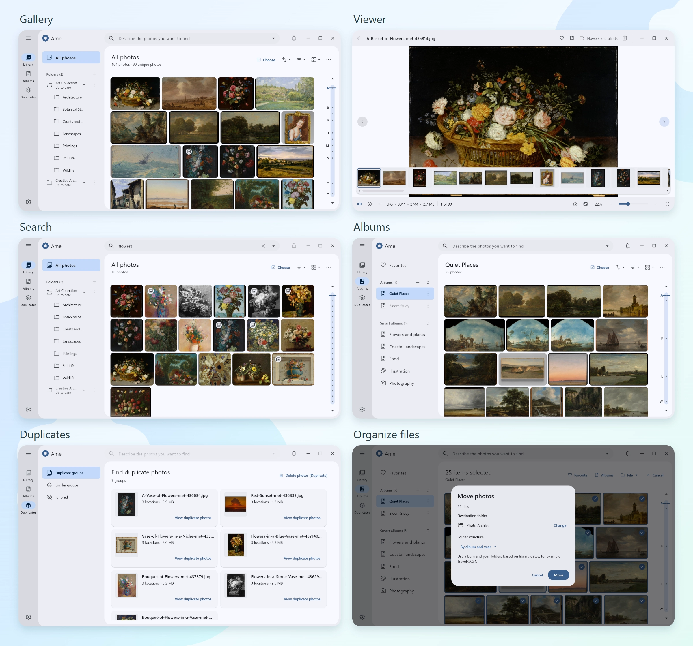

<p align="center"><a href="./README.md">English</a> | <a href="./README.zh-Hans.md">简体中文</a> | 日本語</p>

Ame は、写真や画像の日常的な閲覧・整理に使える Windows 向けローカル画像ライブラリアプリです。画像の閲覧、自然言語検索、自動分類、重複・類似画像の整理、ファイル管理の機能を備えています。[Apache-2.0 ライセンス](LICENSE)で公開されている、無料のオープンソースソフトウェアです。



## ダウンロード

Ame は現在 **Alpha 版**です。主要機能は実装済みで、Beta 版に向けて性能と安定性の改善を進めています。[リリースページ](https://github.com/Cedarflake/Cedarflake-Ame/releases)から **Windows 11 x64** 向けのパッケージをダウンロードできます。

- **MSI インストーラー**には画像解析モデルとランタイムが含まれています。ライブラリをバックグラウンドで更新する Windows サービスもインストールします。インストールには管理者権限が必要です。
- **ポータブル版 ZIP** はインストール不要で利用できます。画像解析モデルは初めて使うときにダウンロードされ、Windows サービスはインストールされません。

[Windows 11 向けプレビュー版](https://github.com/Cedarflake/Cedarflake-Ame/actions/workflows/quality_windows_arm64.yml)には、x64 版と ARM64 版の MSI、および ARM64 用のポータブル版 ZIP があります。Arm 搭載 PC で x64 版 MSI から ARM64 版 MSI に切り替える場合は、既存の MSI 版をアンインストールしてから再インストールする必要があります。

アプリ内での更新に対応し、自動確認と自動ダウンロードを選べます。リリース版とプレビュー版のパッケージは未署名です。変更点や既知の制限は[リリースノート](docs/releases/README.md)に記載しています。

## 主な機能

### ギャラリーの閲覧と自動同期

写真を縦横比のまま並べるレイアウトと正方形グリッドに対応し、異なるフォルダーやドライブの画像を一つのライブラリで閲覧できます。フォルダー単位の表示や、撮影日時・作成日時・更新日時・ファイル名による並べ替え、タイムラインを使った日付ごとの閲覧も可能です。

ファイルの追加・変更・移動・削除をバックグラウンドで監視し、ライブラリに反映します。アプリの終了中に発生した変更も、次回の起動後に同期されます。

### 画像の検索と絞り込み

ファイル名、パス、自然言語の説明、画像を使った検索に対応しています。検索範囲をフォルダーやアルバムに限定し、ファイル形式、撮影・作成・更新日時、画像の寸法、ファイルサイズ、カメラ情報による絞り込みを組み合わせられます。

重複グループや類似グループだけを表示する絞り込みにも対応しています。写真の一覧レイアウトやタイムラインを保ったまま、現在の表示範囲内で画像を探したり比較したりできます。

### スマートアルバム

SigLIP 2 を使って PC 上で画像を自動分類し、対応デバイスでは GPU アクセラレーションを利用できます。分類結果はスマートアルバムとして表示され、ライブラリの変化に合わせて更新されます。

標準の分類項目は名前や特徴の説明を編集でき、独自の項目も追加できます。標準の項目は個別または一括で初期状態に戻すことができ、一括リセットでも独自の項目や有効・無効の設定は保たれます。

### お気に入り・アルバム・整理モード

お気に入りと仮想アルバムは独立しており、用途に合わせて画像を整理できます。アルバムのアイコンの変更や、アルバム間での画像の移動にも対応しています。

整理モードでは、未整理、後で整理、整理済み、対象外の状態を管理します。整理の進行状況と閲覧位置を保存して後から続きを再開でき、整理操作の取り消しとやり直しも可能です。

### 重複・類似画像の整理

ファイルの内容が完全に一致する画像と、見た目が似ている画像を別々にグループ化し、類似度の判定基準を調整できます。重複画像はギャラリーでまとめて表示したり展開したりでき、グループ内の画像や保存場所の確認、画像の比較、優先して残す画像の指定、グループの整理対象からの除外に対応しています。

一つのグループ、選択した複数のグループ、現在のグループ一覧全体を対象に整理できます。重複画像の整理では優先する画像を、類似画像の整理では選択した画像を残します。指定がない場合は、自動で選ばれた代表画像を残します。

### ファイル管理と年別整理

コピー、移動、名前の変更、ごみ箱への移動、完全削除に対応しています。一括操作、進行状況の表示、操作履歴に加え、対応する操作では中断後の処理再開も可能です。

アルバムに含まれる実際のファイルを、年別のフォルダーへ移動できます。既定の構成は `移動先/アルバム名/年` で、年の判定にはライブラリの日付情報を使います。ファイルの競合、スキップされた項目、失敗の内容は操作結果に記録されます。

### 画像の表示と比較

拡大・縮小、ウィンドウに合わせた表示、原寸表示、表示の回転、全画面表示、2 枚の画像を並べた比較に対応しています。サムネイル一覧で前後の画像を切り替えられ、ビューアーから戻った後もギャラリーの閲覧位置が保たれます。

画像情報には、ファイル形式、寸法、ファイルサイズ、パス、カメラ情報、日時が含まれます。表示中の画像をシステムのクリップボードへコピーし、他のアプリで貼り付けて利用することもできます。

### インターフェースとデスクトップ機能

Material 3 のインターフェースを採用し、ライト、ダーク、システムに合わせたテーマに対応しています。アクセントカラーは Windows の設定に連動します。日本語、英語、簡体字中国語の表示に加え、キーボードショートカットやローカル診断情報のエクスポートも利用できます。

## ソースから実行する

Ame は開発中です。Windows 11 x64 でビルドするには、Flutter **3.50.0**、[rust-toolchain.toml](rust-toolchain.toml) で指定された Rust ツールチェーン、Visual Studio 2022 が必要です。Visual Studio では「C++ によるデスクトップ開発」ワークロード、Windows SDK、CMake ツールをインストールしてください。Windows on Arm でビルドする場合は、[ARM64 のビルド手順](docs/acceptance/quality/commands.md#build-on-windows-arm64)を参照してください。

```powershell
flutter pub get
flutter run -d windows
```

画面には Flutter と Material 3 を使用しています。Rust がカタログ、ファイルの変更追跡、プレビュー、画像解析、ファイル操作を担当し、ライブラリのデータは SQLite に保存されます。

詳しくは[ロードマップ](docs/roadmap.md)、[開発ガイド](docs/development/repository-layout.md)、[ビルドとテストのコマンド](docs/acceptance/quality-gates.md)、[アーキテクチャの解説](docs/architecture/README.md)を参照してください。

## ライセンス

Copyright 2026 Cedarflake Ame contributors.

特記がある場合を除き、Cedarflake Ame には [Apache License, Version 2.0](LICENSE)（`Apache-2.0`）が適用されます。サードパーティのコード、依存ライブラリ、モデルの重み、リソースには、それぞれのライセンスと表記が適用されます。

利用条件は[エンドユーザー使用許諾契約](EULA.md)（英語）を参照してください。
情報の取り扱いは[プライバシーに関する声明](PRIVACY.md)（英語）を参照してください。
