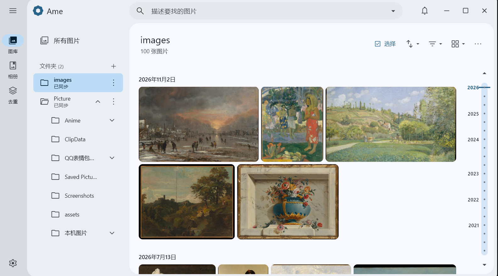

<p align="center"><a href="./README.md">English</a> | <a href="./README.zh-Hans.md">简体中文</a> | 日本語</p>

Ame は、大量の画像を自分の PC で閲覧、検索、整理できる Windows アプリです。普段使っているフォルダーを追加すると、重複した写真やよく似た写真を探したり、お気に入りやアルバムにまとめたりできます。



## ダウンロード

Ame は現在 **Alpha 版**です。[リリースページ](https://github.com/Cedarflake/Cedarflake-Ame/releases)から **Windows 11 x64** 向けのパッケージをダウンロードできます。

- **MSI インストーラー**には画像解析モデルとランタイムが含まれています。ライブラリをバックグラウンドで更新する Windows サービスもインストールします。インストールには管理者権限が必要です。
- **ポータブル版 ZIP** は、すべてのファイルを展開してから `Cedarflake-Ame/Cedarflake Ame.exe`（旧パッケージでは `cedarflake_ame.exe`）を実行してください。画像解析モデルは初めて使うときにダウンロードされます。Windows サービスのインストールは不要です。

[Windows 11 向けプレビュー版](https://github.com/Cedarflake/Cedarflake-Ame/actions/workflows/quality_windows_arm64.yml)には、x64 版と ARM64 版の MSI、および ARM64 用のポータブル版 ZIP があります。Arm 搭載 PC で x64 版の MSI を使用している場合は、先にアンインストールしてから ARM64 版をインストールしてください。

**設定 → このアプリについて**から更新を確認してダウンロードし、再起動すると更新が適用されます。更新設定では自動確認と自動ダウンロードを選べます。この項目がない旧版は、アプリを終了してから手動で更新してください。旧ポータブル版の更新先には別のフォルダーを使ってください。リリース版とプレビュー版のパッケージは未署名です。変更点や既知の制限は[リリースノート](docs/releases/README.md)に記載しています。

## 写真を閲覧する

写真を縦横比のまま一覧表示したり、正方形のグリッドに並べたりできます。タイムラインから日付を選ぶと、その日の写真に移動します。写真を開いたら、拡大、回転、2 枚の比較ができます。画面下のサムネイルを展開すると、前後の写真も選べます。ギャラリーに戻ると、直前まで見ていた位置から閲覧を続けられます。

異なるドライブのフォルダーを同じライブラリに追加でき、特定のフォルダーだけに絞って表示することもできます。Ame はファイルの変更をバックグラウンドで反映します。アプリを閉じていた間の変更を反映している間も、写真を閲覧できます。

## 写真を探す・比較する

ファイル名やパスで検索したり、探したい写真を言葉で説明したり、表示中の写真に関連する画像を探したりできます。ファイル形式、日付、画像の寸法、ファイルサイズ、カメラ情報による絞り込みも組み合わせられます。スマートアルバムは SigLIP 2 を使って PC 上で写真を分類します。対応するデバイスでは GPU アクセラレーションが既定で有効になっており、設定からオフにできます。

内容が完全に一致するファイルは重複写真として検出されます。ギャラリーで複数のコピーを 1 枚にまとめ、それぞれの保存場所を確認したり、重複写真の画面で比較したりできます。グループの代表にする写真を選ぶことも、すべて残したいグループを整理対象から除外することもできます。見た目が似ている写真は別にグループ化され、類似度の基準を調整できます。

## 写真を整理する

写真をお気に入りやアルバムに追加し、アルバムごとにアイコンを選べます。写真を 1 枚ずつ整理しているときは進行状況が保存され、次回は続きから再開できます。

Ame から Windows の機能を使ってファイルのコピー、移動、名前の変更、削除ができます。削除すると通常はごみ箱に移動します。完全に削除する場合は、その操作を明示的に選びます。重複写真や類似写真を整理するときは、自分で選んだ写真が残ります。選んでいない場合はグループの代表写真が残り、削除前に対象のファイル数を確認できます。結果はファイル操作履歴で確認でき、中断した操作は内容に応じて再開できます。

[使い方ガイド](docs/user-guide.ja.md)では、画像の追加、モデルの準備、更新、整理記録のバックアップ、診断情報の共有を説明しています。

## ソースから実行する

Ame は開発中です。Windows 11 x64 でビルドするには、Flutter **3.50.0**、[rust-toolchain.toml](rust-toolchain.toml) で指定された Rust ツールチェーン、Visual Studio 2022 が必要です。Visual Studio では「C++ によるデスクトップ開発」ワークロード、Windows SDK、CMake ツールをインストールしてください。Windows on Arm でビルドする場合は、[ARM64 のビルド手順](docs/acceptance/quality/commands.md#build-on-windows-arm64)を参照してください。

```powershell
flutter pub get
flutter run -d windows
```

画面には Flutter と Material 3 を使用しています。Rust がカタログ、ファイルの変更追跡、プレビュー、画像解析、ファイル操作を担当し、ライブラリのデータは SQLite に保存されます。

詳しくは[ロードマップ](docs/roadmap.md)、[開発ガイド](docs/development/repository-layout.md)、[ビルドとテストのコマンド](docs/acceptance/quality-gates.md)、[アーキテクチャの解説](docs/architecture/README.md)を参照してください。

## ライセンス

Copyright 2026 Cedarflake Ame contributors.

特記がある場合を除き、Cedarflake Ame には [Apache License, Version 2.0](LICENSE)（`Apache-2.0`）が適用されます。サードパーティのコード、依存ライブラリ、モデルの重み、リソースには、それぞれのライセンスと表記が適用されます。
