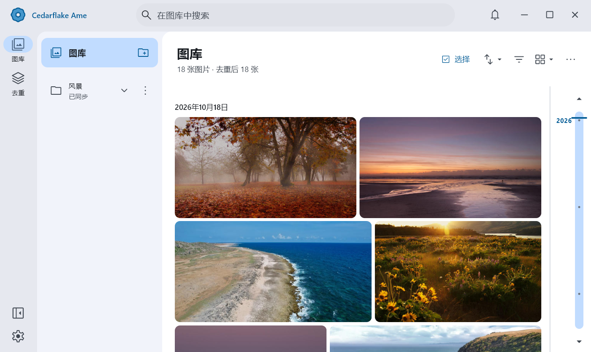

Ame is a Windows app for browsing large image collections and finding exact duplicates.
Add the folders you already use, browse them together, and see where each copy of an image lives.
Your files stay where they are.



## Browse your collection

Scroll through a photo wall or a square grid, jump to a date with the timeline, and search by
name or path. Open an image for a closer look, then return to the same place in the gallery.
Folders from different drives appear in one library, and you can narrow the view to a single source.

Ame watches for file changes and updates the library in the background. You can keep browsing
while it catches up after being closed.

## Make sense of duplicates

Exact duplicate detection finds files with identical contents. Fold their copies into one gallery
item, inspect the individual locations, or open the duplicate view to compare them. You can choose
which copy represents a group and ignore groups you want to keep.

Cataloging and analysis run locally. The database and thumbnail cache are stored separately from
your pictures; browsing and duplicate review leave the originals untouched. Cloud-only files are
left online.

## Run from source

Ame is still in development. To build it, use Windows 11 x64, Flutter **3.47.8**, the Rust toolchain
in [rust-toolchain.toml](rust-toolchain.toml), and Visual Studio 2022 with the **Desktop development
with C++** workload, Windows SDK, and CMake tools.

```powershell
flutter pub get
flutter run -d windows
```

The interface is built with Flutter and Material 3. Rust handles the catalog, file tracking,
previews, and duplicate analysis, with SQLite storing the library.

For more detail, see the [roadmap](docs/roadmap.md),
[development guide](docs/development/repository-layout.md),
[build and test commands](docs/acceptance/quality-gates.md), or the
[architecture notes](docs/architecture/README.md).
