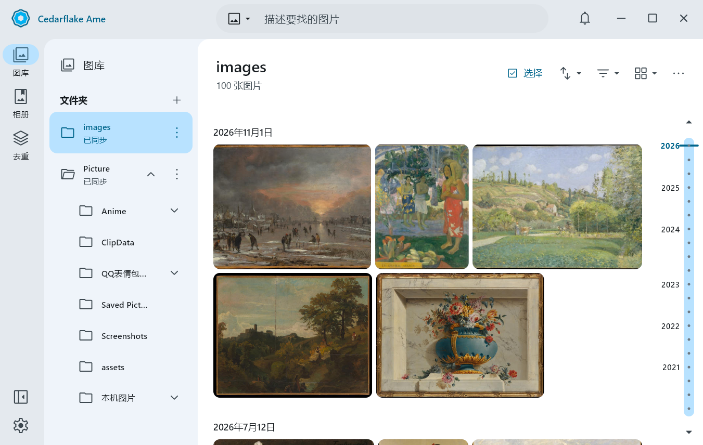

Ame is a local-first Windows app for browsing, searching, and organizing large image collections.
Add the folders you already use, find duplicates and similar images, and organize your collection
with favorites, albums, or file operations.



## Download

Ame is currently in **Alpha**. Each [release](https://github.com/Cedarflake/Cedarflake-Ame/releases)
provides two packages for **Windows 11 x64**:

- **MSI installer**: includes the image-analysis models, runtime, and background library-update
  service. Installation requires administrator permissions.
- **Portable ZIP**: extract the complete archive and run `Cedarflake-Ame/cedarflake_ame.exe`.
  Models download separately when first needed; no Windows service is installed.

Releases are unsigned and do not yet update automatically. Close Ame before upgrading, and keep
portable versions in separate directories. See the [release notes](docs/releases/README.md)
for changes and known limits.

## Browse your collection

Scroll through a photo wall or a square grid and jump to a date with the timeline.
Open an image for a closer look, compare two images, or rotate the viewing direction.
An expandable thumbnail strip lets you browse nearby images over the main preview.
Return from the viewer to the same place in the gallery.
Folders from different drives appear in one library, and you can narrow the view to a single source.

Ame watches for file changes and updates the library in the background. You can keep browsing
while it catches up after being closed.

## Find and compare images

Search by filename or path, describe an image in natural language, or find images related to the
one you are viewing. Combine filters for file format, date, dimensions, file size, and camera details.
Smart albums classify images locally with SigLIP 2. GPU acceleration is enabled by default on
supported devices and can be switched off in settings.

Exact duplicate detection finds files with identical contents. Fold their copies into one gallery
item, inspect the individual locations, or open the duplicate view to compare them. You can choose
which copy represents a group and ignore groups you want to keep. Similar-image groups use a
separate visual comparison with an adjustable similarity level.

## Organize your collection

Choose album icons, collect favorites, add images to albums, and resume reviewing images from
your saved place.

When you want to change files, Ame supports copying, moving, renaming, and deletion through Windows.
Deletion defaults to the Recycle Bin; permanent deletion requires an explicit choice. Duplicate and
similar-group cleanup retain your keep choices, or the automatic representative when none was chosen,
and confirm the number of files before deletion. Operation records show results and support
recovery of interrupted work where applicable.

## Run from source

Ame is still in development. To build it, use Windows 11 x64, Flutter **3.47.8**, the Rust toolchain
in [rust-toolchain.toml](rust-toolchain.toml), and Visual Studio 2022 with the **Desktop development
with C++** workload, Windows SDK, and CMake tools.

```powershell
flutter pub get
flutter run -d windows
```

The interface is built with Flutter and Material 3. Rust handles the catalog, file tracking,
previews, image analysis, and file operations, with SQLite storing the library.

For more detail, see the [roadmap](docs/roadmap.md),
[development guide](docs/development/repository-layout.md),
[build and test commands](docs/acceptance/quality-gates.md), or the
[architecture notes](docs/architecture/README.md).

## License

Copyright 2026 Cedarflake Ame contributors.

Except where otherwise noted, Cedarflake Ame is licensed under the
[Apache License, Version 2.0](LICENSE) (`Apache-2.0`).
Third-party code, dependencies, model weights, and resources retain their own licenses and notices.
