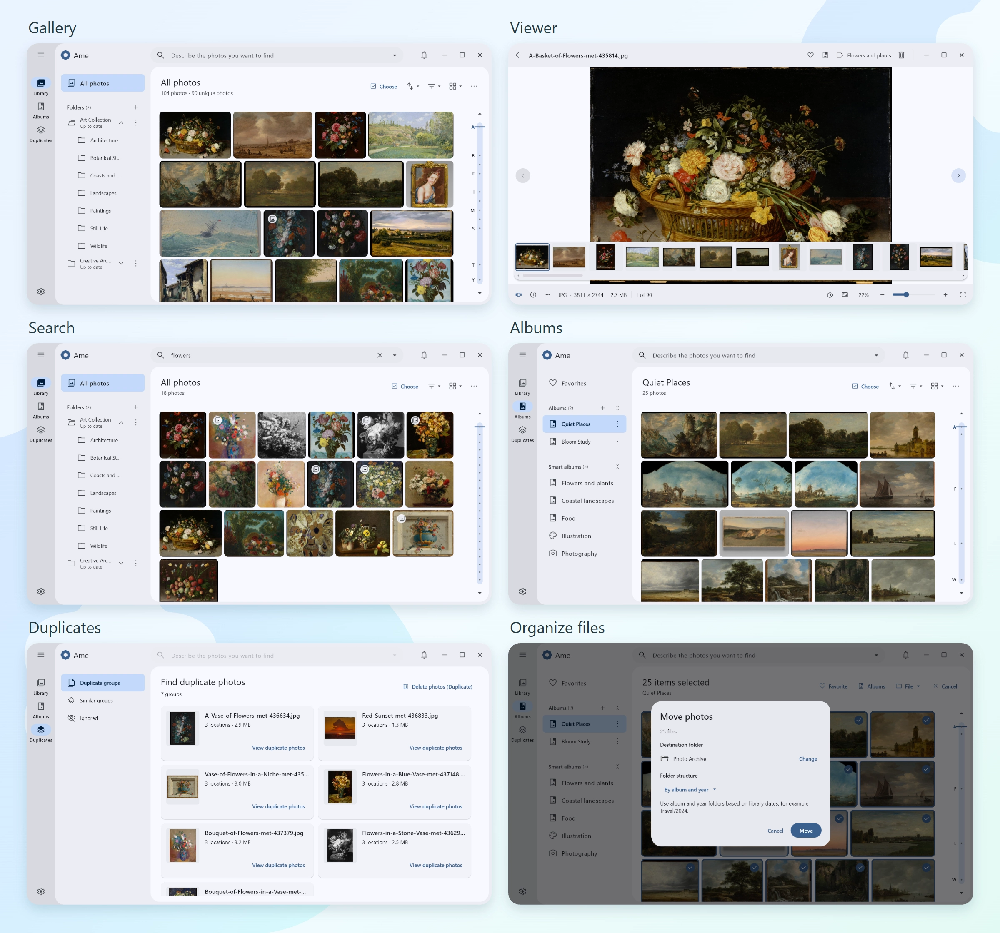

<p align="center">English | <a href="./README.zh-Hans.md">简体中文</a> | <a href="./README.ja.md">日本語</a></p>

Ame is a local-first Windows photo library for everyday use, with image browsing, intelligent
search, automatic classification, and duplicate cleanup. It works with existing image folders and
supports timeline browsing, favorites, albums, and file management.
It is free and open source under [Apache-2.0](LICENSE).



## Download

Ame is currently in **Alpha**. Its main features are implemented, with performance and stability
being refined for Beta. Each [release](https://github.com/Cedarflake/Cedarflake-Ame/releases) provides
two packages for **Windows 11 x64**:

- **MSI installer**: includes the image-analysis models, runtime, and background library-update
  service. Installation requires administrator permissions.
- **Portable ZIP**: runs without installation. Image-analysis models download when first needed;
  no Windows service is installed.

The [Windows 11 previews](https://github.com/Cedarflake/Cedarflake-Ame/actions/workflows/quality_windows_arm64.yml)
include MSI packages for x64 and ARM64 and a portable ZIP for ARM64. Switching from an installed
x64 MSI to ARM64 requires uninstalling the x64 version first.

Ame supports in-app updates, with automatic checking and downloading options.
Release and preview packages are unsigned. See the [release notes](docs/releases/README.md)
for changes and known limits.

## Features

### Browsing and automatic synchronization

Photo wall and square-grid layouts bring folders from different drives into one library, with
folder-scoped browsing. Images can be sorted by capture, creation, modification date, or filename,
with a timeline for browsing by date.

Background monitoring tracks added, changed, moved, and deleted files. Changes made while Ame is
closed are synchronized after the next launch.

### Search and filters

Search by filename, path, natural-language description, or a related image. Searches can be scoped
to folders or albums and combined with filters for format, capture/creation/modification dates,
dimensions, file size, and camera information.

Duplicate-only and similar-group filters keep the gallery's photo wall and timeline for browsing
and comparison within the current collection.

### Smart albums

SigLIP 2 classifies images locally, with GPU acceleration on supported devices. Results appear as
smart albums and update as the library changes.

Built-in category names and feature descriptions are editable, and custom terms can be added.
Defaults can be restored for one term or all built-in terms; a full reset preserves custom terms
and enabled states.

### Favorites, albums, and organization mode

Favorites and virtual albums provide independent ways to organize images. Albums offer a choice
of icons and support moving images between collections.

Organization mode tracks pending, deferred, organized, and ignored images. It saves progress and
browsing position for later continuation, with undo and redo for organization actions.

### Duplicate and similar-image cleanup

Byte-identical and visually similar images form separate groups, with adjustable similarity
strictness. Exact duplicates can be folded or expanded in the gallery. Group review includes
members, file locations, comparison, preferred-image selection, and ignored groups.

Cleanup is available within a group, across selected groups, or for the current group list.
Exact cleanup retains the preferred image; similar-image cleanup retains the selected images.
When no choice is specified, the automatic representative is retained.

### File management and year-based organization

File operations include copying, moving, renaming, recycling, and permanent deletion, with batch
actions, progress feedback, operation history, and continuation of supported interrupted work.

Album files can be moved into year folders using the default structure
`destination/album name/year`, with years taken from library dates. Operation results record
conflicts, skipped items, and failures.

### Image viewing and comparison

The viewer supports zoom, fit-to-window, actual size, viewing rotation, full screen, and
side-by-side comparison. A thumbnail strip provides nearby-image navigation, while returning
from the viewer preserves the gallery position.

Image information includes format, dimensions, file size, path, camera details, and dates.
The displayed image can also be copied to the system clipboard for use in other applications.

### Interface and desktop features

The Material 3 interface supports light, dark, and system themes, with an accent color that follows
Windows. Simplified Chinese, English, and Japanese interfaces are available, alongside keyboard
shortcuts and local diagnostic exports.

## Run from source

Ame is still in development. To build it, use Windows 11 x64, Flutter **3.50.0**, the Rust toolchain
in [rust-toolchain.toml](rust-toolchain.toml), and Visual Studio 2022 with the **Desktop development
with C++** workload, Windows SDK, and CMake tools.
For Windows on Arm, see the [ARM64 build instructions](docs/acceptance/quality/commands.md#build-on-windows-arm64).

```powershell
flutter pub get
flutter run -d windows
```

The interface is built with Flutter and Material 3. Rust handles the catalog, file tracking,
previews, image analysis, and file operations, with SQLite storing the library.

For more detail, see the [roadmap](docs/roadmap.md),
[development guide](docs/development/repository-layout.md),
[build and test commands](docs/acceptance/quality-gates.md), or the
[architecture notes](docs/architecture/README.md).

## License

Copyright 2026 Cedarflake Ame contributors.

Except where otherwise noted, Cedarflake Ame is licensed under the
[Apache License, Version 2.0](LICENSE) (`Apache-2.0`).
Third-party code, dependencies, model weights, and resources retain their own licenses and notices.

End-user terms are described in [EULA.md](EULA.md).
Information handling is described in the [Privacy Statement](PRIVACY.md).
