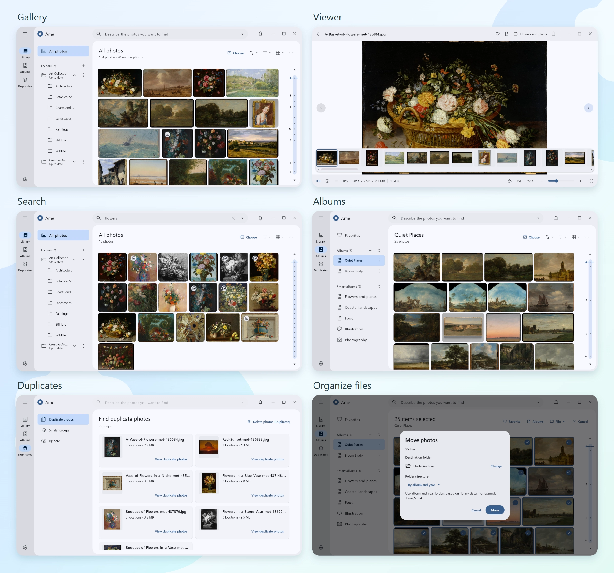

<p align="center"><a href="./README.md">English</a> | 简体中文 | <a href="./README.ja.md">日本語</a></p>

Ame 是一款在本地浏览、搜索和整理大量图片的 Windows 应用。把平时存放图片的文件夹添加到图库，就可以查找重复或相似的图片，用收藏和相册整理它们，也可以直接管理文件。



## 下载

Ame 目前处于 **Alpha 阶段**。在[发布页面](https://github.com/Cedarflake/Cedarflake-Ame/releases)可以下载适用于 **Windows 11 x64** 的安装版或便携版。

- **MSI 安装程序**需要管理员权限。安装包自带图片分析模型和运行时，并会安装用于在后台更新图库的 Windows 服务。
- 使用**便携版 ZIP** 时，请先完整解压，再运行 `Cedarflake-Ame/Cedarflake Ame.exe`（旧包为 `cedarflake_ame.exe`）。便携版不安装 Windows 服务，图片分析模型会在首次使用时下载。

[Windows 11 预览版](https://github.com/Cedarflake/Cedarflake-Ame/actions/workflows/quality_windows_arm64.yml)提供 x64 和 ARM64 两种 MSI 安装包，以及 ARM64 便携版 ZIP。如果你的 Arm 电脑上已安装 x64 版 MSI，请先卸载，再安装 ARM64 版。

在**设置 → 关于**中检查和下载更新，下载完成后重启应用即可更新。更新设置可选择自动检查或自动下载。没有此入口的旧版需要先关闭应用，再手动升级；便携版请解压到新的文件夹。发布包和预览包均未签名。各版本的改动和已知限制见[发行说明](docs/releases/README.md)。

## 浏览图库

可以用图片墙或方形网格浏览图片，也可以沿时间轴跳到想看的日期。打开大图后，可以放大查看、对比两张图片或旋转画面。展开底部的缩略图条，就能切换到前后的图片。退出大图后会回到图库中原来的位置。

不同硬盘上的文件夹可以放进同一个图库，也可以只浏览其中一个来源。Ame 会在后台跟踪文件变化。如果文件在应用关闭期间发生了变化，下次打开时可以照常浏览，图库会在后台更新。

## 查找和比较图片

可以按文件名或路径搜索，用自然语言描述想找的画面，或从当前图片查找相关图片。还可以组合使用文件格式、日期、图片尺寸、文件大小和相机信息等筛选条件。智能相册使用 SigLIP 2 在本地为图片分类。在支持的设备上，GPU 加速默认开启，可以在设置中关闭。

Ame 按文件内容识别完全相同的图片。在图库中，可以把多个副本折叠成一项，查看每份文件的位置，也可以打开重复图片视图进行比较。你可以为每组选择一张代表图，如果打算保留整组，也可以将它标记为忽略。画面相似的图片会单独分组，你可以调整相似度。

## 整理图库

可以收藏图片、将图片加入相册，也可以为相册选择图标。逐张整理图片时，Ame 会保存进度，下次可以从上次停下的地方继续。

Ame 支持通过 Windows 复制、移动、重命名和删除文件。删除的文件默认进入回收站，也可以手动选择永久删除。清理重复或相似图片时，Ame 会保留你选定的图片。如果没有手动选择，就保留自动选出的那张。删除前会请你确认文件数量。你可以在操作记录中查看结果，部分操作中断后也可以恢复。

[使用指南](docs/user-guide.zh-Hans.md)介绍图片导入、模型准备、更新、整理记录备份和诊断信息导出。

## 从源码运行

Ame 仍在开发中。在 Windows 11 x64 上构建需要 Flutter **3.50.0**、[rust-toolchain.toml](rust-toolchain.toml) 指定的 Rust 工具链，以及 Visual Studio 2022。安装 Visual Studio 时，请勾选「使用 C++ 的桌面开发」工作负载，并安装 Windows SDK 和 CMake 工具。在 Windows on Arm 设备上构建请参阅 [ARM64 构建指南](docs/acceptance/quality/commands.md#build-on-windows-arm64)。

```powershell
flutter pub get
flutter run -d windows
```

界面使用 Flutter 和 Material 3 构建。Rust 负责图库索引、文件跟踪、预览、图片分析和文件操作，图库数据存储在 SQLite 中。

更多信息见[路线图](docs/roadmap.md)、[开发指南](docs/development/repository-layout.md)、[构建与测试命令](docs/acceptance/quality-gates.md)和[架构说明](docs/architecture/README.md)。

## 许可证

版权所有 © 2026 Cedarflake Ame 贡献者。

除另有说明外，Cedarflake Ame 使用 [Apache 许可证 2.0](LICENSE)（`Apache-2.0`）。第三方代码、依赖项、模型权重和资源各自适用其原有的许可证和声明。

使用条款见[最终用户许可协议](EULA.md)（英文）。
信息处理方式见[隐私声明](PRIVACY.md)（英文）。
