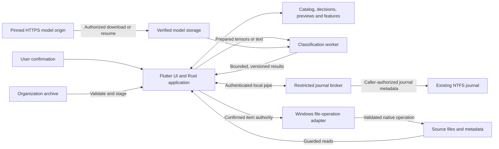

# Cedarflake Ame threat model

Scope: Windows 11 x64 desktop, Rust workers, optional installed journal broker, local storage,
model acquisition and release delivery.

Source baseline: [`b943677c`](https://github.com/Cedarflake/Cedarflake-Ame/commit/b943677c4884b9ad94a668b3eefbbfcf3917030c),
reviewed on 2026-11-15. Published prereleases can lag this baseline; assess a reported vulnerability
against its actual release tag or commit.

This document maps attack scenarios to existing controls and residual exposure. It introduces no
new runtime guarantee or delivery milestone. Linked ADRs own the technical decisions, the
[roadmap](../roadmap.md) owns unfinished work, and [SECURITY.md](../../SECURITY.md) owns reporting.

## Assets and security objectives

| Asset | Required protection |
| --- | --- |
| Original media and source namespaces | Browsing and analysis remain read-only; physical changes require explicit, bounded authorization; no automatic placeholder hydration. |
| Catalog, albums, favorites, overrides and operation history | Preserve coherent publication and durable intent through interruption, migration and recovery. |
| Paths, metadata, thumbnails, embeddings, archives and diagnostics | Treat derived data as private even when original images are absent. |
| Desktop user and other local users | Untrusted content must not acquire extra authority or disclose another user's protected filesystem information. |
| Installed service, model/runtime bytes and release artifacts | Admit the intended code and artifacts without expanding service privileges or publication credentials. |
| Memory, CPU/GPU, disk and UI availability | Bound input handling and background work; retain cancellation and recoverable failure paths. |

## Actors and assumptions

Consider a party supplying a crafted image, filename, directory tree, model response or organization
archive; a local process racing changes in a writable source or output directory; another local
interactive user connecting to the journal pipe; and a compromised dependency, distribution host or
untrusted pull request.

Windows, its kernel and access-control enforcement are trusted. An administrator or malware already
controlling the desktop user's token can access that user's files and tamper with writable application
data. Ame is not a boundary against complete host or account compromise. This assumption does not
excuse the journal broker exposing stronger rights to an ordinary caller, or an untrusted file
gaining code execution in the first place.

Sources and cached records can change between observations. A filename, root string, file extension,
archive identifier or successful model prediction is not sufficient authorization for a file operation.
Classification is advisory; user decisions and confirmed physical-operation scope remain authoritative.

## Data flow and trust boundaries

| Boundary | Admission and authority |
| --- | --- |
| Source filesystem to application | Root-relative namespace checks, native identity/revision evidence, availability checks and held read capabilities. Explicit file operations have a separate mutation path. |
| Flutter to Rust | Generated `flutter_rust_bridge` contracts and opaque task lifetimes. This is an in-process ownership boundary, not an authenticated network API or protection from a compromised desktop process. |
| Application to classification worker | Anonymous pipes, bounded frames/tensors, matching session/request/pipeline identities, verified native artifacts and Windows Job limits. |
| Ordinary client to journal service | Local-only named pipe, OS-observed caller identity, client/server authentication, impersonated access checks and root-scoped disclosure. |
| External bytes to managed storage | Pinned model transport and digest checks; separately validated archive staging; atomic publication after admission. |
| Build inputs to distributed application | Read-only candidate/package verification precedes the separate release publisher. Unsigned artifacts still require trust in the repository and release channel. |

This model assumes an unelevated desktop session; classification workers inherit the launching
process's security context. Worker separation and Job limits contain crashes and resource use;
they do not establish an AppContainer or filesystem sandbox. The worker protocol supplies pixels
or text rather than source paths and exposes no catalog API; exploited native code can still
exercise its process token's rights.
Some image and metadata parsing remains in the desktop process.

## Threat scenarios and existing controls

### T1 — Crafted media or inference input compromises availability or execution

Wrong extensions, malformed headers, oversized images and hostile native-model input can trigger
parser defects, excessive allocations or crashes. Content recognition is bounded and distinct from
pixel decoding. Classification source admission limits encoded size, dimensions, pixel count and
decoder allocation. Native inference uses supervised workers with bounded protocol input, memory,
process count and cancellation/retirement ownership.

Residual exposure includes in-process parser defects, native runtime or GPU-driver vulnerabilities,
and aggregate storage/resource pressure. Per-input and worker limits do not prove every sustained
workload is bounded. Review the actual decoder and backend when extending formats or models.
Owners: [media boundary](0002-rust-owned-catalog-and-media-boundaries.md),
[classification protocol](0034-versioned-classification-contracts.md#worker-ownership-and-protocol),
[GPU execution](0039-gpu-classification-execution.md).

### T2 — Namespace substitution escapes a root or publishes stale content

A writable ancestor, reparse point, rename, hard link or cloud availability change can invalidate a
previous path check. Source access uses held namespace/file evidence and revalidates identity,
revision and availability before publishing derived results. Cached results retain source and
pipeline identity; uncertain evidence cannot establish a trustworthy completed scan.

An unavailable cloud file must remain unavailable until separately authorized access; a matching
path or old thumbnail cannot authorize reading replacement bytes. Reparse handling is operation
specific, so callers must use the owning adapter rather than a generic string-prefix check.
Owners: [continuity and source guards](0024-windows-change-driven-library-continuity.md),
[`viewer_source_guard`](../../rust/src/adapters/local_files/viewer_source_guard.rs).

### T3 — File organization mutates an unintended file or replays an old command

Selections are frozen before confirmation. Durable authorization binds the item, source evidence,
action and destination policy; new discoveries cannot enlarge that confirmed set. Native operations
revalidate the source and guarded directories and avoid overwriting destinations. Cross-volume moves
record and verify the copy before separately admitting source removal. Unknown outcomes require
inspection; restart and history enumeration do not replay mutation authority.

**Accepted residual risk:** Windows recycling uses `IFileOperation` and path-based Shell resolution.
Another process with sufficient directory rights can replace the source after the last check, and
Windows may recycle that replacement. Held handles block content writers but delete sharing remains
necessary for recycling. Explicit permanent deletion uses the validated source handle and has a
different identity guarantee; it is not an automatic fallback or a recovery mechanism.
Owner: [ADR 0042](0042-windows-file-operations.md#recycling-identity-boundary), implemented by the
[`Windows adapter`](../../rust/src/adapters/windows_file_operations.rs) and
[`durable journal`](../../rust/src/adapters/sqlite_catalog/file_operations.rs).

### T4 — A local client abuses the privileged journal broker

Pipe squatting, forged process/session claims, replayed connection proofs or out-of-root requests
could turn journal access into cross-user disclosure or privilege escalation. The broker validates
its restricted LocalSystem service profile. Its protected local pipe rejects remote clients;
connection-bound proofs are checked against OS process/token facts. The client authenticates the
installed service and protected image identity. Every disclosed scope is checked under the captured
caller token, including ancestor listing and containment.

The broker reads an existing journal; its protocol does not grant media-content reads, source writes
or journal creation/reset. A client need not have an approved executable path or signature: caller
rights and root evidence provide authorization. Service authentication failure falls back to the
explicit `LiveOnly` mode. Local denial of service and defects in unsafe Win32/IPC code remain review
targets. Owner: [broker boundary](0024-windows-change-driven-library-continuity.md#journal-broker-boundary);
implementation: [`pipe admission`](../../rust/src/journal_broker/windows/pipe_listener.rs) and
[`caller-scoped disclosure`](../../rust/src/journal_broker/service/windows_security/disclosure.rs).

### T5 — Model delivery or DLL lookup admits substituted code or data

Managed downloads use fixed artifacts/revisions, HTTPS, an admitted redirect-host set, exact lengths,
range validation and SHA-256 checks. Resume requires retained installation intent; an absent model
alone does not authorize a download. Staging and publication retain namespace/file guards. Workers
verify model/runtime bytes before use and restrict native DLL lookup to the admitted runtime
directory and Windows system libraries. Tokenizer network support and ONNX telemetry are disabled.

Hashes detect substitution relative to trusted pins; they do not make a malicious upstream artifact
safe or authenticate a repository already controlled by an attacker. Model hosts still receive
ordinary connection/request metadata. Owners:
[model installation](0034-versioned-classification-contracts.md#managed-model-installation),
[`download admission`](../../rust/src/adapters/classification_runtime/installation/download.rs),
[`pinned model manifest`](../../rust/src/adapters/classification_runtime/model_distribution.json).

### T6 — An organization archive imports forged authority or exhausts storage

Imports are streamed into a private staging database with bounded records, framing/digest checks,
typed schemas and relational validation. Inspection is separate from application. Restore rechecks
the inspected identity/checksum and current revisions, remaps foreign identities, preserves current
local decisions and commits atomically. Imported history cannot authorize a fresh undo or filesystem
mutation; input and original media remain read-only.

An archive checksum is an integrity check, not a sender signature. Well-formed imported decisions
can still be unwanted, and bounded records do not make a very large archive cheap in total disk or
time. Owners: [archive admission and restoration](0031-portable-organization-archives.md),
[`archive codec`](../../rust/src/adapters/sqlite_catalog/organization_archive/codec.rs).

### T7 — Interruption or stale asynchronous work corrupts durable state

A crash, late callback, reused identifier or changed source can publish obsolete results, lose user
choices or repeat a completed mutation. Application-owned generations and source leases fence
publication; SQLite transactions keep related decisions and receipts coherent. Completed scans
remain distinct from staging, and human decisions remain separate from rebuildable caches.
Filesystem mutation and SQLite commit are separate transitions, with durable receipts and explicit
reconciliation rather than a claim of cross-system atomicity.

These controls depend on every caller preserving the same authority and lifetime rules. Cancellation
does not undo a completed file operation, and catalog recovery is not a backup of original media.
Owners: [catalog publication](0002-rust-owned-catalog-and-media-boundaries.md#catalog-publication),
[classification authority](0035-classification-decision-authority.md),
[operation recovery](0042-windows-file-operations.md#durable-intent-and-outcome-journal).

### T8 — Derived data or diagnostic sharing exposes a private library

Catalogs and exports can reveal filenames, paths, metadata, albums and user choices; thumbnails,
features and crash dumps can disclose additional content. Storage classes remain outside source
trees and have different retention rules. Model network errors omit signed redirect URLs and server
bodies; repository/release rules exclude real libraries, catalogs and machine-specific identity data.

Local-first processing does not encrypt these stores or make diagnostic bundles anonymous. Windows
account permissions and machine/storage protection remain necessary. Sharing an archive, log or
dump requires deliberate inspection and redaction; do not assume every diagnostic path is already
sanitized. Owners: [storage governance](0005-storage-governance-and-budget.md),
[reporting policy](../../SECURITY.md#report-a-vulnerability).

### T9 — Supply-chain or release substitution reaches users

Dependencies, native runtimes, model metadata and packaging tools cross a code-trust boundary.
Repository workflows pin external actions to commit SHAs and limit token permissions. Candidate
and package gates validate source/artifact identity and hashes. Artifact reuse checks provenance and
receipts. Release publication is a separate main-only job with content-write permission and no
repository checkout; release notes are read as bounded data from the trusted workflow revision.

Current releases are unsigned and have no automatic updater. Hashes and CI evidence cannot replace
publisher authentication or withstand compromise of all trusted repository/release records. Optional
signing support does not establish that a release is signed or its signing environment is configured.
Owners: [distribution and reuse](0015-windows-release-distribution.md),
[installer lifecycle](0027-windows-installer-lifecycle.md),
[`release publisher`](../../.github/workflows/release_publish_windows.yml).

## Maintaining this model

Update the affected scenario when changing source access, physical-operation authorization,
archive schemas, parser/model/runtime dependencies, worker privileges or protocol, broker identity
and disclosure, storage/diagnostic retention, installer ACLs or release credentials/provenance.
Record a new source baseline when rechecking the model; do not append a chronological audit diary.

For each affected boundary, select a rejecting regression as well as the intended successful path:
changed/reparse/cloud sources, stale or widened mutation scope, malformed or replayed IPC, wrong
caller/root access, tampered artifacts, invalid archives, interrupted publication or hostile release
inputs. Use existing boundary suites and disposable fixtures under the
[verification workflow](../acceptance/quality/verification-workflow.md) and
[test-design standard](../development/testing.md). Product acceptance and CI results belong in their
existing owners; editing this document does not establish that those checks have run.
